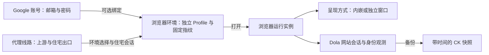

# Cloak Workbench 功能关系与交互审查

审查日期：2026-10-15。范围：浏览器工作台、环境管理、Google 账号库、代理管理、自动登录、登录检测、持久化与 CK、窗口生命周期、诊断。

结论：现有代理、独立 Profile、原生窗口嵌入、登录辅助与会话备份已有可复用基础。主要问题是功能逐次增加后，没有统一页面职责、对象命名、状态含义和操作路径。当前应先整理这些关系，再扩展业务功能。

本轮只做审查与建议，没有修改业务代码、账号、代理配置、指纹或网站登录。新建表单、保存、真实登录、代理切换和 CK 恢复未执行。

## 证据与检查范围

本轮检查了真实窗口、可访问性树和当前代码。截图由本轮工作台窗口捕获并保存，已打开复核。遇到截图显示其他前台应用的情况时，该截图被拒绝，没有作为工作台证据；后续桌面出现用户操作，未继续争抢前台。账号列表与其明文密码显示、其他未捕获表单的结论来自当前实现，没有将旧截图或历史回归冒充本轮现场验证。

1. 浏览器工作台：环境栏、标签、浏览器工具栏和实际网页。
2. 环境操作菜单：详情、账号绑定、Google 登录、备份、资料、配置、检测和关闭。
3. 环境管理：总览、筛选、批量入口及保留的登录侧栏。
4. 环境详情：单个环境的动作、登录检测、代理与资料。
5. 代理管理：列表、检测入口、列顺序和结果表达。
6. 代码检查：账号存储与绑定、两套密码入口、创建与批量导入、地区匹配、CK 导入、窗口运行与呈现状态、诊断。

### 步骤 1：浏览器工作台

- 第二列固定宽度 252 DIP，每张环境卡片约 200 DIP 高，三条记录就占满主要高度。名字、分组、运行、绑定、登录、时间、出口、检测、切换和更多菜单均在卡片内。
- 环境卡片的切换按钮与上方标签重复；“当前会话”以主要按钮样式表达状态；头像和“未分组”占据日常任务不需要的空间。
- 浏览器外侧有全局导航、环境栏，网站内部还有自己的导航。多层侧栏挤压真实网页，绿色的当前页、当前环境、已登录等不同含义也相互争夺注意力。
- 建议浏览器页专注运行：顶部保留环境标签；第二列改为可折叠的紧凑运行列表；完整资料放到环境详情。整行点击切换，关闭按钮与更多菜单是次级动作。

### 步骤 2：环境操作菜单

- “环境详情”“编辑环境资料”“环境配置”同时出现，用户无法由名称判断边界。
- 同一菜单混合窗口动作、登录动作、配置动作与备份动作。绑定后还会多出“使用绑定账号自动登录”，与“通过 Google 登录”同时存在。
- 建议保留“打开 / 切换”“登录账号”“环境设置”“登录备份”“关闭浏览器”等稳定动作；设置内再分基本资料、账号、代理、指纹。动作按运行、配置、维护分组。

### 步骤 3：环境列表与侧栏

- 优点：环境表格支持筛选、多选、批量执行，详情已经可以页内展示。
- 侧栏出现后表格宽度明显缩小，需要水平滚动。侧栏顶部堆叠打开、登录检测、代理检测、Google 登录、账号绑定、备份等多个按钮，仍需用户自己挑路径。
- 列表“最近检测”取登录与网络两个时间中的较新值；详情却分别显示不同时间。用户可能把刚完成的网络检测时间理解为登录检测时间。
- “已确认登录”概览包含关闭环境的历史结果。截图中已打开 3 个，但已确认登录为 6 个；这个计数不能直接读成“现在有 6 个在线账号”。
- 建议行内主动作直接显示“打开”；详情中的状态卡分别标注“浏览器”“Dola 登录”“网络”“绑定身份”。普通表格列优先保证环境、账号、国家、运行、登录、操作；详细分组、检测依据放侧栏。

### 步骤 4：代理列表

- 上游与住宅出口的连接关系已清楚展示，检测也能区分临时会话快照与环境观测，这是保留项。
- 国家在 ISP、评分、住宅属性、ASN 之后，绑定环境数和检测时间更靠右。当前窗口下用户反而先看到大量技术信息。
- “检测当前”和“检测所选”分别依赖当前行和复选框，两套选择方式需要解释；未选择目标时，部分操作仍可点击后才报提示。
- 建议默认列为名称、国家 / 城市、连接状态、质量、绑定环境、最近检测、操作；IP、ISP、ASN、住宅属性、完整地址等留在详情或自选列。国家始终在首屏。
- 线路测试成功、某环境实际出口正常、Dola 可用是三种结论，不能共用一个绿色“可用”。住宅会话可能让多个环境的真实出口不同。

## 应当统一的对象关系

| 对象 | 唯一职责 | 不应暗示的含义 |
| --- | --- | --- |
| Google 账号 | 邮箱、密码、账号分组与备注 | 保存凭据不代表网页已登录 |
| 浏览器环境 | 独立 Profile、固定指纹、代理选择、可选账号绑定 | 环境名称不代表已核验的 Google / Dola 身份 |
| 浏览器运行实例 | 进程、打开状态、内嵌或独立窗口 | 从工作台弹出不代表进程关闭 |
| Dola 登录观测 | 环境内网站是否登录、检测时间、身份核验程度 | 网站已登录不代表登录的是绑定邮箱 |
| 代理线路 | 住宅出口与可选上游、认证、会话策略 | 线路列表中的 IP 不一定是每个环境的当前出口 |
| CK / 登录备份 | 某环境在某时间的可恢复会话快照 | 导入不是新增 Google 账号，也不保证服务端继续接受会话 |

当前“一账号绑定一个环境”的规则适合第一阶段，应保留。手动登录而没有保存 Google 密码的环境也合法，界面应标注“手动登录环境”，避免“未绑定”被误认为故障。

## 功能关系中的关键问题

### 1. 登录状态没有区分“已登录”和“身份一致”

`worker/account_status.py` 检查站点登录布尔值、站点用户标识是否存在和账号菜单，不比较绑定的 Google 邮箱。`worker/google_login.py` 对绑定账号遇到现有会话会暂停为 `existing_session_unverified`，这个保守处理是合理的；但浏览器卡片只显示“绑定某邮箱”加“已确认登录”，容易让用户得出二者已核对一致的结论。

建议明确表达“Dola 已登录 · 身份未核验”。只有站点能提供足够证据时才标注匹配；不能用显示名称推断邮箱一致，也不能为了核验而自动退出用户现有登录。

### 2. 历史结果被当作当前状态展示

`AccountManagement.__init__()` 会恢复已存 `accountCheck`；`summary()` 没有单纯因关闭、重启或时间经过而降级。历史结果对恢复很有用，但现在的绿色状态与总览缺少“历史”语义。代理可连接也基于上次结果，需要把检测时间和来源放在可见位置。

建议保留历史证据，显示“上次已登录 · 2 小时前”。新运行实例尚未观察网页时标注“本次待检测”。刷新管理列表只应重新读数据；真正检测应明确说明会检查什么。

### 3. 账号库建立后，旧入口仍形成第二套资料来源

当前独立账号库保存 Google 凭据，同时 `GoogleCredentialStore` 仍可按环境记住密码；环境里又有 `accountEmail` 旧标识、环境分组与备注，账号库里也有分组与备注。它们用途不同，但页面没有让用户轻松理解差别。

建议正常流程只在账号列表维护邮箱和密码；Google 登录页默认使用绑定账号，没有绑定时引导“选择账号 / 仅本次登录”。旧凭据迁移入口收进维护操作，“旧版邮箱标识”退出正常创建表单，账号分组与环境分组分别命名。

用户选择的明文密码查看与编辑方式保持不变；本轮没有建议重新隐藏密码。

### 4. 创建入口没有统一

`CreateAccountDialog()` 提供快速新建，`CreateProfileDialog()` 是另一套完整环境表单，环境中心又有批量创建与资料导入。快速创建与完整设置使用窗口，环境资料另有页内编辑，而账号库已经用页内侧栏。

批量导入主要创建环境资料，导入的邮箱标识不是 Google 凭据绑定。用户若把它当成账号密码批量导入，会得到一批仍需重新配置账号的环境。

建议统一“新建环境”页内表单与同一数据提交逻辑；简单模式只选名称、账号、代理，指纹默认生成稳定配置，高级设置折叠。批量入口明确区分“导入 Google 账号”和“批量创建环境”，完成后给出创建、绑定和待登录数量。

### 5. 地区自动匹配主要发生在编辑器

当前地区推荐会在编辑表单检测后填入语言与时区；启动仍使用已保存的 `locale`、`timezone`。`regionMode=proxy` 不能被解释成“每次启动都会根据当下真实出口重新匹配”。尤其住宅线路的列表临时检测、环境实际会话和后续轮换出口可能不同。

建议先确定环境的住宅会话，再检测该环境的真实出口，创建时据此推荐并保存地区；后续启动发现明显不一致时展示原因和可执行的调整入口。已有环境指纹保持稳定，运行中不因一次网络检测静默改变语言、时区或随机指纹。语言和时区一致也不能保证 Dola 放开地区限制。

### 6. 运行状态和窗口呈现状态混在一起

`MainWindow.Refresh()` 的工作台会话数量使用 `hosts.Count`，而环境表格的打开数量使用 worker 返回的进程状态。`ToggleExternal()` 将窗口弹出时从 `hosts` 移除，但浏览器进程仍运行，因此两个页面可能出现不同数量。恢复所选会话也主要依赖已附加窗口集合。

建议运行实例统一记录进程与呈现方式。弹出独立窗口只改变 `displayMode`，不改变“运行中”；按钮分别叫“切换到窗口”“嵌回工作台”“关闭浏览器”。普通用户无需理解原生 HWND、父窗口或宿主字典。

### 7. CK 恢复动作与结果名称不够清楚

当前 CK 导入和本机备份恢复最终通过 `import_new()` 创建新环境，保留源环境，这个实现边界合理。但入口叫“恢复”时用户可能以为会修复当前环境；一份网站会话可以被导入到多份环境，不等同于多份独立账号。

建议明确区分“继续使用原环境”“用备份创建恢复环境”“导出备份”。导入完成分别呈现环境创建、数据恢复、Dola 登录确认三个结果；失败时提供继续检查或手动登录，不能只给“待确认”。

### 8. 任务反馈分散，操作前提不够明显

代理检测、环境检测、Google 登录、CK 操作各自有进行状态和任务规则，但用户跨页后缺少统一的进行中提示。环境详情里仍有多个互不相关按钮，部分不可用原因只在 tooltip。

建议先统一轻量任务摘要，显示“某环境正在登录 / 需要手动处理 / 检测完成”。禁用动作旁说明原因，例如“关闭浏览器后才能修改代理”；验证码与两步验证保留手动接管。暂不增加复杂的任务编排系统。

## 建议的页面职责

| 页面 | 主要任务 | 主动作 |
| --- | --- | --- |
| 浏览器工作台 | 使用已打开的网页，切换运行环境 | 切换、关闭、打开环境列表 |
| 环境管理 | 创建、配置、关联与批量管理环境 | 新建环境、打开浏览器、环境设置 |
| Google 账号 | 管理邮箱与密码，查看绑定关系 | 添加 / 导入账号、配置浏览器、登录账号 |
| 代理管理 | 管理线路与上游、检测、查看使用环境 | 添加代理、检测所选、查看绑定环境 |
| 诊断与维护 | 日志、内核信息、迁移与高级检查 | 查询与排错，日常界面弱化入口 |

环境设置统一采用页内详情，分为概览、账号、代理、指纹、登录备份。浏览器页可临时打开当前环境详情，完成后回到原浏览器，不强制跳到另一张管理表格。文件选择 / 导出仍使用系统对话框。

## 主要流程

1. 新账号：添加 Google 邮箱和密码 → 为账号创建或选择环境 → 选择代理 → 检测真实出口并推荐地区 → 保存固定指纹 → 打开并执行 Google 登录 → 验证 Dola → 保留 Profile。
2. 日常使用：选择环境 → 打开浏览器 → 继续原网站会话；仅确实需要登录时再执行“登录账号”。关闭浏览器不应被描述成退出账号。
3. 手动账号：创建环境 → 手动登录 → 日常继续使用；保存 Google 密码始终可选。
4. 更换代理：定位使用该线路的环境 → 明确关闭要求 → 修改 → 用环境真实会话检测 → 核对地区 → 重开。共享线路编辑应直接列出受影响环境。
5. 登录异常：先区分网络失败、网站已退出、地区受限、身份未核验和等待人工验证，再给对应动作；不把它们全部归成“需要重新登录”。
6. CK：从环境导出快照；恢复时明确新建恢复环境，保留原环境，并用实际网站结果确认。

## 调整优先级与验收

第一批：统一对象与状态语义，修正历史状态及独立窗口计数；精简浏览器环境栏，突出网页；统一打开、登录、检测的动词。

第二批：合并环境详情 / 资料 / 配置为页内设置；账号到环境的创建绑定形成一条路径；清理旧标识，区分账号导入与环境导入；国家、绑定关系与检测时间前置。

第三批：把地区一致性、登录异常恢复和 CK 新环境恢复接入相同的反馈规则，再处理完整视觉样式、任务摘要和细节。

验收应覆盖：手动已登录环境未绑定账号仍可正常使用；绑定邮箱不被误报为当前网站身份；重开旧环境不把历史绿色当作本次检测；独立窗口弹出 / 嵌回不改变运行总数；关闭标签保留 Profile；普通新建与批量创建的账号、代理、指纹行为一致；切页不丢任务与未提交资料；代理检测结果不会自动更换运行中指纹。

可见的可访问性风险是 10–11 DIP 的辅助信息、多个小型图标动作、颜色含义重复，以及可访问性名称仍叫“账号中心 / 搜索账号”而视觉标签已改成环境。字体、焦点顺序、键盘操作、屏幕阅读器和对比度需要后续专项验证，本轮不声称可访问性合规。

## 实现定位

- `desktop/AccountManagement.cs`：固定环境栏、卡片、菜单、快速创建、状态命名。
- `desktop/MainWindow.cs`：hosts / profiles、标签、打开关闭、独立窗口、完整配置、恢复工作台。
- `desktop/AccountCenter.cs`、`desktop/AccountCenterDesign.cs`：环境管理、汇总时间、详情、资料、批量导入。
- `desktop/LoginAccounts.cs`、`worker/login_accounts.py`：独立账号库、明文显示、绑定。
- `desktop/GoogleLogin.cs`、`worker/google_login.py`、`worker/google_credentials.py`：绑定账号登录、仅本次登录、按环境记住密码与暂停状态。
- `desktop/ProxyManagement.cs`、`desktop/ProxyGeography.cs`、`worker/proxy_catalog.py`、`worker/proxy_sessions.py`：代理快照、环境出口、上游与住宅会话。
- `desktop/FingerprintEditor.cs`、`worker/account_management.py`：地区推荐、随机指纹、批量地区匹配。
- `worker/account_status.py`、`worker/account_management.py`：登录证据、历史观测、组合健康状态。
- `desktop/SessionBackup.cs`、`worker/session_backup.py`：备份、CK 预览、新环境恢复与结果。

建议下一步先定稿“浏览器工作台 + 环境详情”的页面分工和状态规则，再按第一批范围改动。
